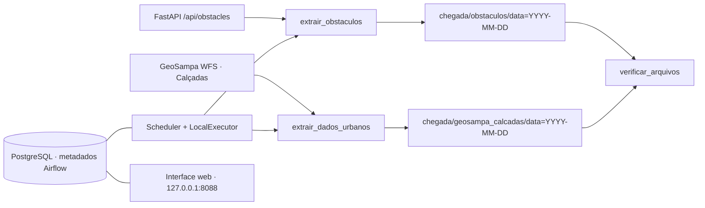

# ROTA LIVRE | Ingestão de dados

A stack lê duas fontes por HTTP e preserva as respostas brutas em `chegada/`. O Airflow agenda e verifica os lotes. A API, o frontend e a stack de monitoramento continuam em seus projetos Docker.



## Fontes verificadas em 12/11/2026

| Fonte e responsável | Interface e formato | Campos e finalidade | Uso |
|---|---|---|---|
| Obstáculos do ROTA LIVRE, equipe do projeto | `http://api:8000/api/obstacles`, JSON com `total` e `obstaculos` | `id`, `tipo`, `latitude`, `longitude`, `status`. Pontos de interesse do mapa do projeto. | Dados internos fornecidos pelo próprio código. Nenhuma licença pública específica identificada na revisão inspecionada. |
| Calçadas (`geoportal:calcada`), Prefeitura de São Paulo via GeoSampa, coordenado pela SMUL com apoio da Prodam | WFS 2.0 GetFeature, GeoJSON em EPSG:4326, coordenadas longitude/latitude | `id`, `geometry` e `properties`, incluindo código da calçada, logradouro, área, larguras, declividades, campos do Plano Emergencial de Calçadas e situação. Permite associar os pontos do mapa ao entorno de passeios públicos. | CC BY-SA 4.0. Atribua os dados à Prefeitura de São Paulo / GeoSampa e observe a licença no compartilhamento de adaptações. |

O briefing cita `/obstaculos`. Na revisão `3cb9869`, [backend/main.py](https://github.com/victoriafpizza/GlobalSolution2026/blob/3cb9869/ROTA-LIVRE/backend/main.py) expõe `GET /api/obstacles`. A instância em execução respondeu HTTP 404 à primeira rota e HTTP 200 à segunda. Os dois registros estão definidos diretamente em `listar_obstaculos` e são exemplos estáticos do projeto, sem persistência e sem evidência de coleta em campo. A ingestão preserva o retorno efetivo da API.

A camada Calçadas foi identificada no [GetCapabilities](https://wfs.geosampa.prefeitura.sp.gov.br/geoserver/geoportal/wfs?service=WFS&version=2.0.0&request=GetCapabilities). O [GetFeature com o recorte da DAG](https://wfs.geosampa.prefeitura.sp.gov.br/geoserver/geoportal/wfs?service=WFS&version=2.0.0&request=GetFeature&typeNames=geoportal%3Acalcada&outputFormat=application%2Fjson&srsName=EPSG%3A4326&bbox=-46.64%2C-23.556%2C-46.628%2C-23.545%2Curn%3Aogc%3Adef%3Acrs%3AOGC%3A%3ACRS84) usa a janela `-46.64,-23.556,-46.628,-23.545`, em ordem oeste, sul, leste, norte, incluindo os dois pontos do projeto. O recorte limita o volume diário. A validação exige que as feições entregues correspondam ao total retornado pelo serviço para a janela, detectando truncamento. A consulta global `resultType=hits` informou 491.383 feições no dia da inspeção. [Publicação da camada](https://prefeitura.sp.gov.br/noticia/informacoes-sobre-calcadas-da-cidade-podem-ser-consultadas-no-geosampa/) · [Tutorial WFS](https://geoinfo-smdu.github.io/tutorial-geosampa-internet-2.0/) · [Licença oficial](https://prefeitura.sp.gov.br/web/licenciamento/w/licen%C3%A7a-para-uso-de-dados-do-geosampa).

## Pré-requisitos e inicialização no Windows

Validação em Docker Desktop 4.74.0, Engine 29.4.3 (contêineres Linux), Compose 5.1.3, Airflow 2.10.5 com Python 3.11 e PostgreSQL 16.15. A API em execução, iniciada pelo checkout anterior `C:\GlobalSolution2026`, tinha Python 3.11.18 e FastAPI 0.115.12. A revisão de código de ambos os checkouts era `3cb9869`. O Dockerfile e requirements da revisão inspecionada especificam Python 3.13, FastAPI 0.162.2 e Uvicorn 0.54.0. O frontend declara React 19.3, Vite 8.3 e Leaflet 1.9.

A entrega Big Data está em `C:\GSBigData\big-data`. A API de origem pertence ao ROTA LIVRE e é acessada pela rede Docker compartilhada. Confirme que a API está nessa rede. Se o projeto ainda estiver parado, inicie o Compose do projeto. Se houver conflito de porta com monitoramento, defina `ROTA_LIVRE_METRICS_PORT` para uma porta livre antes de subir a aplicação.

```powershell
Set-Location 'C:\GSBigData\GlobalSolution2026\ROTA-LIVRE'
docker network inspect rota-livre_rota-livre-network
docker compose ps
# Somente se a aplicação original precisar ser iniciada
# docker compose up -d
Set-Location 'C:\GSBigData\big-data'
Get-NetTCPConnection -State Listen -LocalPort 8088 -ErrorAction SilentlyContinue
if (-not (Test-Path .env)) {
    $config = Get-Content -Raw .env.example
    $config = $config.Replace('troque_por_hex_aleatorio', [guid]::NewGuid().ToString('N'))
    $config = $config.Replace('troque_por_senha_local', [guid]::NewGuid().ToString('N'))
    Set-Content -Encoding utf8 .env $config
}
# Acrescenta chaves novas ao .env existente e preserva valores já configurados.
$config = Get-Content -LiteralPath .env
foreach ($key in @('AIRFLOW_FERNET_KEY', 'AIRFLOW_WEB_SECRET_KEY')) {
    if ($config -match "^$key=.+$") { continue }
    $bytes = [Security.Cryptography.RandomNumberGenerator]::GetBytes(32)
    $value = if ($key -eq 'AIRFLOW_FERNET_KEY') {
        [Convert]::ToBase64String($bytes).Replace('+', '-').Replace('/', '_')
    } else {
        [Convert]::ToHexString($bytes).ToLowerInvariant()
    }
    if ($config -contains "$key=") {
        $config = $config -replace "^$key=$", "$key=$value"
    } else {
        $config += "$key=$value"
    }
    Set-Content -LiteralPath .env -Encoding utf8 $config
}
docker compose config -q
docker compose up -d --wait --wait-timeout 180
docker compose ps -a
docker compose exec -T scheduler airflow dags list-import-errors
docker compose exec -T scheduler airflow dags list
```

Use uma porta livre em `AIRFLOW_PORT` caso 8088 esteja ocupada. Para redes com outro nome, ajuste `ROTA_LIVRE_NETWORK` e, se necessário, `ROTA_LIVRE_API_URL`. O scheduler entra na rede da API e resolve `api` pelo DNS do Docker. A interface web e o PostgreSQL ficam na rede própria. O banco e os logs usam volumes nomeados. Os lotes usam o bind mount local `./chegada`. A senha do PostgreSQL deve ser hexadecimal para interpolação direta na URL de conexão. A interface está em [Airflow local](http://127.0.0.1:8088), com credenciais definidas em `.env`.

Para parar ou retomar somente este ambiente, no diretório `big-data` use `docker compose stop` ou `docker compose up -d --wait`. Os lotes e o banco são persistidos.

## Agenda, execução e verificação

A DAG `rota_livre_ingestao_diaria` roda diariamente às **03h00 em America/Sao_Paulo**, com `catchup=False` e uma execução ativa por vez. As duas extrações são independentes e podem rodar em paralelo. Cada tarefa tem até duas novas tentativas, com intervalo de dois minutos e limite de três minutos por tentativa. A verificação HTTPS combina as CAs do sistema com o bundle público do certifi 2025.01.31 já incluído na imagem. O timeout HTTP padrão é 30 segundos e a resposta tem limite de 64 MiB. A data da pasta vem da `logical_date` convertida para São Paulo. Em uma execução agendada, essa data identifica o início do intervalo diário. A extração registra separadamente o instante de coleta em UTC.

```powershell
$dag = 'rota_livre_ingestao_diaria'
docker compose exec -T scheduler airflow dags trigger $dag --run-id manual__validacao -o json
docker compose exec -T scheduler airflow dags list-runs -d $dag -o table
docker compose exec -T scheduler airflow tasks states-for-dag-run $dag manual__validacao
Get-ChildItem chegada -Recurse -File | Get-FileHash -Algorithm SHA256
Get-Content chegada/*/data=*/metadados.json
Get-Content -Raw tests/test_ingestao.py | docker compose exec -T scheduler python - -v
```

Cada fonte publica uma pasta contendo os bytes recebidos e `metadados.json`. Os metadados registram URL, horário UTC, data lógica, run ID, status, código HTTP, formato, bytes, contagem e SHA-256. A publicação usa uma pasta intermediária no mesmo filesystem e uma renomeação de diretório. Uma interrupção abrupta pode deixar uma pasta oculta `.staging-*`, que não é lida como lote publicado. Em uma reexecução da mesma data, o pipeline verifica o lote, confirma a URL original e reutiliza os arquivos sem nova requisição ou regravação. Lote incompleto, checksum divergente, erro HTTP e resposta inválida geram falha observável na tarefa. A etapa de verificação exige sucesso das duas extrações.

Para repetir exatamente a data lógica, abra a execução original no Grid, selecione as três instâncias da coluna e use **Clear** (ou abra cada instância para limpar o estado). O scheduler voltará a executá-las. Compare SHA-256, timestamps dos quatro arquivos e as mensagens `Reutilizado sem regravação` nos logs.

## Paralelismo e credenciais

O scheduler usa `LocalExecutor` com quatro slots globais. A DAG aceita uma execução ativa por vez, com as duas extrações independentes e `all_success` na verificação. O teste lê os estados e timestamps persistidos pelo scheduler, exige sobreposição positiva e compara o resultado da tarefa com a leitura dos arquivos do host. O cenário de falha executa a mesma DAG com um banco SQLite temporário e uma cópia do lote GeoSampa, provocando HTTP 404 real na API. A verificação fica em `upstream_failed`.

Use PowerShell 7 para gerar o `.env`. As senhas do PostgreSQL e do administrador, a chave Fernet e a chave de sessão web entram por variáveis do Compose. A chave Fernet protege campos sensíveis de Connections e Variables persistidos pelo Airflow. A chave web é compartilhada entre scheduler e interface. Preserve essas chaves quando reutilizar o volume de metadados. O mascaramento de campos sensíveis está explícito no Compose. Use `docker compose config -q` para validar o arquivo sem imprimir os valores interpolados.

URLs das fontes, recorte espacial, timeout, rede e portas são parâmetros operacionais. Como as URLs são gravadas para rastreabilidade, os endpoints configurados devem ser livres de credenciais, query e fragmento. O código monta os parâmetros públicos do WFS e exige HTTPS para seu endpoint. Mantenha tokens também fora do caminho da URL. O `.gitignore` protege arquivos de ambiente, chaves, diretórios de credenciais, estados locais e lotes.

Para reproduzir a etapa 2, escolha um instante lógico passado e ainda livre dentro de um dia com dois lotes válidos. Aguarde `success` antes de executar o validador.

```powershell
$dag = 'rota_livre_ingestao_diaria'
$run = 'manual__validar_paralelismo'
$logical = '<instante ISO 8601 passado com lotes existentes>'
docker compose config -q
docker compose exec -T scheduler airflow dags list-import-errors
docker compose exec -T scheduler airflow dags trigger $dag --run-id $run --exec-date $logical
docker compose exec -T scheduler airflow tasks states-for-dag-run $dag $run
Get-Content -Raw tests/validar_airflow.py | docker compose exec -T scheduler python - run $run
Get-Content -Raw tests/validar_airflow.py | docker compose exec -T scheduler python - failure $logical
Get-Content -Raw tests/test_ingestao.py | docker compose exec -T scheduler python - -v
./tests/auditar_segredos.ps1
```

A auditoria usa Gitleaks 8.30.1 em contêiner e verifica, sem exibi-los, os valores configurados contra os arquivos elegíveis para Git e logs existentes. [Evidências da etapa 2](evidencias/etapa-02/README.md).

## Evidências e próxima etapa

Consulte [evidencias/](evidencias/) e [CHECKLIST_BIG_DATA.md](CHECKLIST_BIG_DATA.md). As capturas verificadas estão em [Grid](evidencias/airflow-grid.png) e [Graph](evidencias/airflow-graph.png). Para repetir a captura do Grid manualmente, entre na DAG, selecione a execução e capture o estado das três tarefas. Para capturar o Graph, mantenha a execução selecionada e clique em **Graph**, exibindo as duas dependências de `verificar_arquivos`. Para novas capturas, use nomes próprios na pasta da etapa correspondente.

A próxima etapa começa pela coleta de dois lotes em dias de coleta distintos e pela transferência dos arquivos e metadados para um Databricks Volume. Depois vêm Bronze, Prata, Ouro, SQL analítico, dashboard e PDF da entrega.


